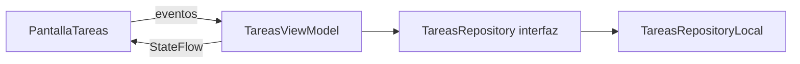
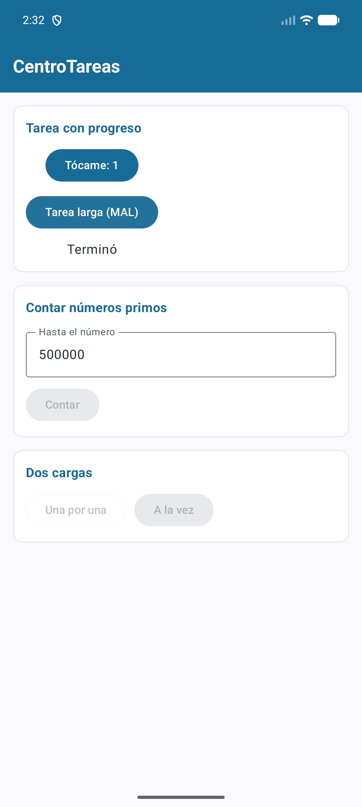
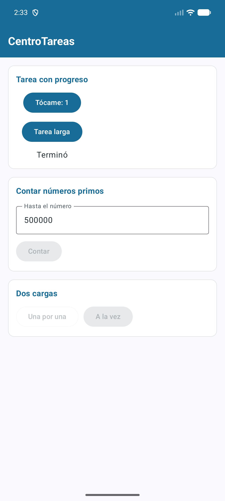
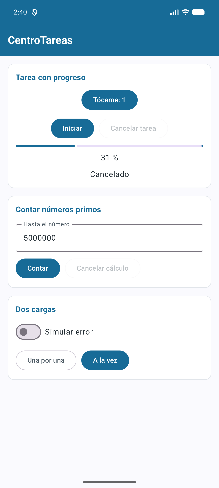
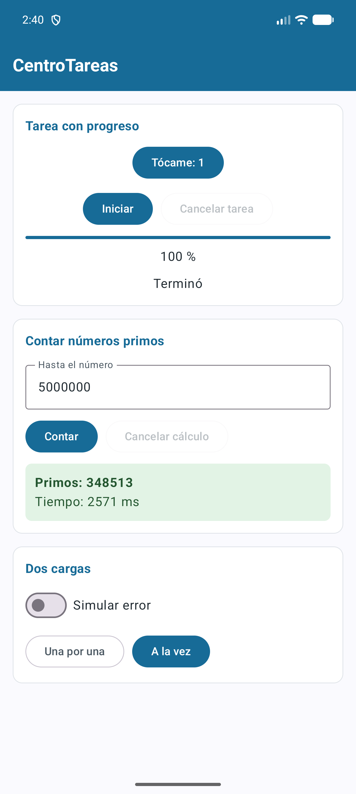
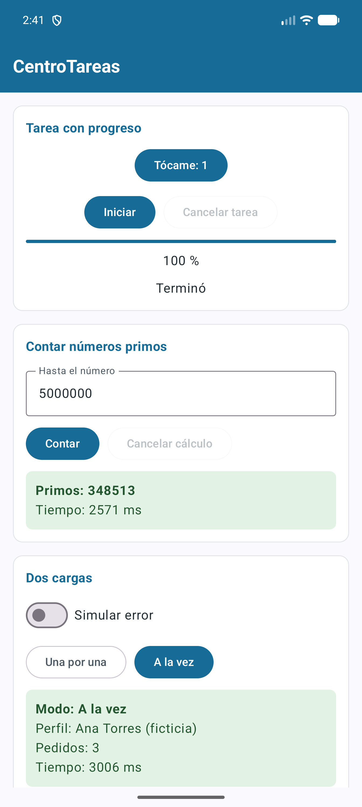
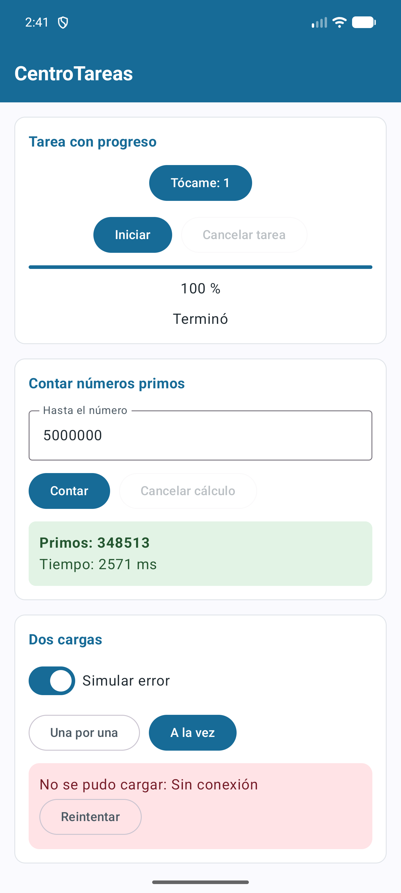

# CentroTareas

Daniella Leon · Laboratorio 14 · Fase 1

Una app para comprobar qué pasa cuando una tarea bloquea la pantalla y cómo resolverlo con corrutinas. Usa Kotlin, Jetpack Compose, Material 3 y MVVM con Repository.

Repositorio público: https://github.com/Daniellaln/CentroTareasLeon

## Abrir y probar

Abre el proyecto en Android Studio con JDK21 y SDK37. Paquete e identificador: `com.leon.centrotareas`. Android7 o superior. No necesita permisos, Firebase ni conexión para funcionar; solo la sincronización inicial descarga dependencias.

Pulsa **Iniciar** y toca **Tócame** mientras avanza. Cancela y vuelve a iniciar. Prueba primos con1000 (resultado168). En **Dos cargas**, compara **Una por una** con **A la vez**; activa el error y desactívalo antes de **Reintentar**.

Los datos son ficticios: Ana Torres, pedidos101/102/103, esperas simuladas de2s y3s. Se añadió cancelar también las cargas para que todo trabajo largo pueda detenerse.

La guía no vino acompañada de un proyecto ejecutable: la base se reconstruyó desde sus contratos y capturas. Esta implementación se hizo con asistencia de Codex; no se presenta como trabajo realizado sin IA ni como una sesión ejecutada en Gemini.

## Código

```text
com.leon.centrotareas/
  MainActivity.kt
  model/Estados.kt
  data/TareasRepository.kt
  data/TareasRepositoryLocal.kt
  viewmodel/TareasViewModel.kt
  viewmodel/TareasViewModelFactory.kt
  ui/PantallaTareas.kt
  ui/theme/Theme.kt
```



La UI observa estado y comunica eventos. El ViewModel coordina Jobs, progreso, estados y tiempos. El Repository calcula primos y simula cargas. El ViewModel no recibe Context ni conoce Composables.

## Observación del Paso 1

Durante la espera de cuatro segundos la pantalla no responde y el contador no se actualiza. Trabajando... no llega a dibujarse porque el hilo principal está ocupado. Un bloqueo suficientemente largo puede provocar un aviso ANR; el momento exacto depende de Android.

La versión bloqueante está en el commit `9de0c8c` (carpeta commit03). El siguiente la reemplaza; el código final no mantiene ese bloqueo. El registro HILO muestra main antes/después y DefaultDispatcher-worker dentro.

## Capturas

Bloqueo y solución con corrutina, tomados de sus respectivos avances:

 

Progreso y cancelación:

 

Primos:



Una por una frente a la vez:

 

Error y reintento:

 

## Para pensar

**¿Por qué no se veía Trabajando...?** El estado cambiaba, pero Android no podía dibujarlo mientras el hilo principal estaba ocupado.

**¿Thread.sleep y delay?** El primero bloquea el hilo. delay suspende la corrutina y deja al hilo atender otro trabajo.

**¿Default para primos e IO para red?** Default se usa para cálculo con CPU; IO para operaciones de entrada/salida bloqueantes. Aquí las cargas usan delay y no hacen red real.

**¿Qué ocurre al cerrar o girar?** viewModelScope cancela los trabajos cuando se destruye definitivamente el ViewModel. En un giro normal se conserva y el trabajo continúa. Ir al escritorio no equivale a destruir la pantalla.

**¿Por qué async tarda3s y qué pasa si falla una carga?** Las esperas se superponen: manda la más larga. coroutineScope cancela la tarea hermana si una falla; el ViewModel muestra el error y permite reintentar.

## Verificación

5 pruebas unitarias y8 instrumentadas sin fallos. Compilación debug y lint sin errores. Evidencias en [docs/VERIFICACION.md](docs/VERIFICACION.md).

Se respetan los nueve commits de la guía, más el cambio de paquete solicitado por Daniella y la calibración del cálculo inicial a cinco millones. Con500000 se midieron332ms, demasiado poco para observar el trabajo. Se ajustó el número, no la duración artificialmente; los valores de referencia de la guía siguen comprobados. No se alteran fechas ni se reescribe el historial. La rama mejora-ia parte del cierre de main; sus mejoras se desarrollarán en fase2.
