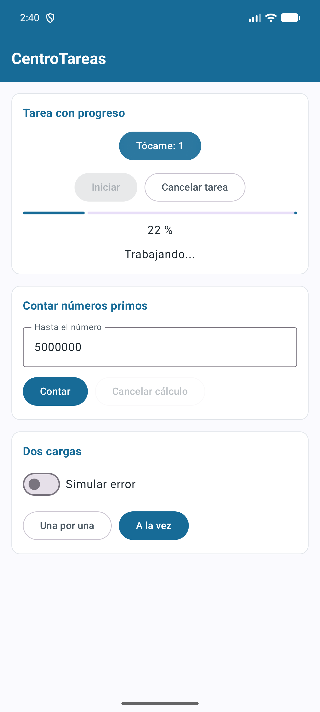
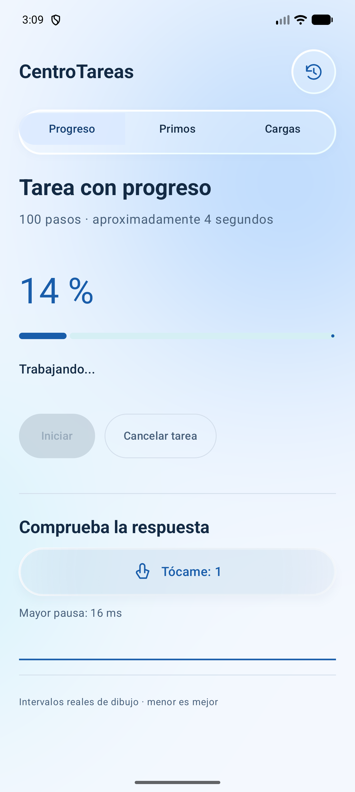
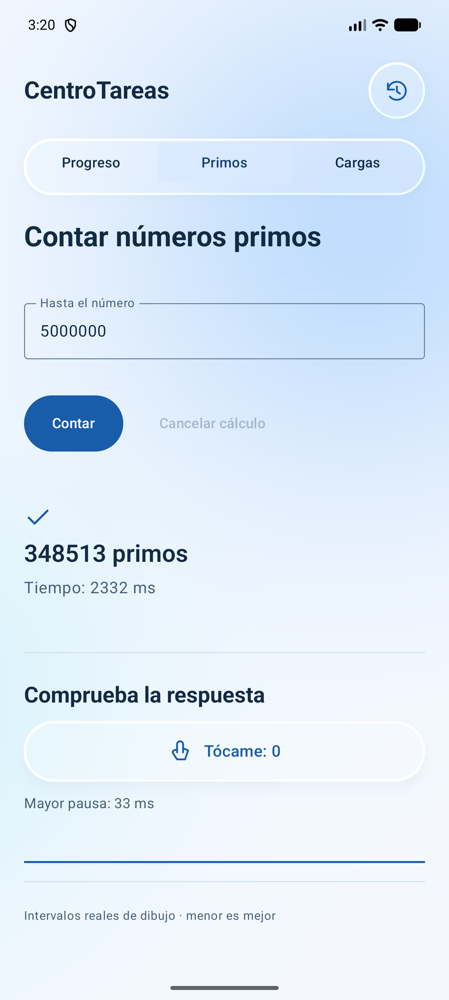
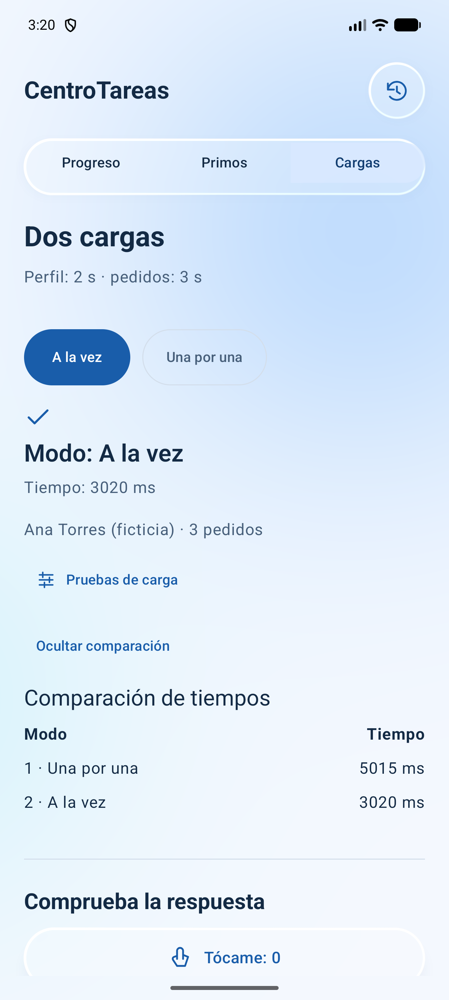
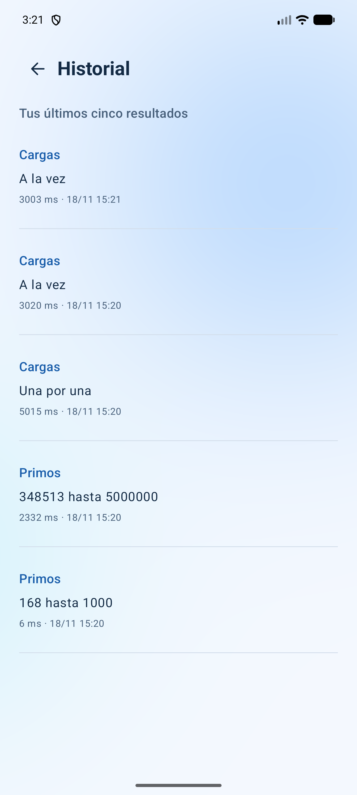
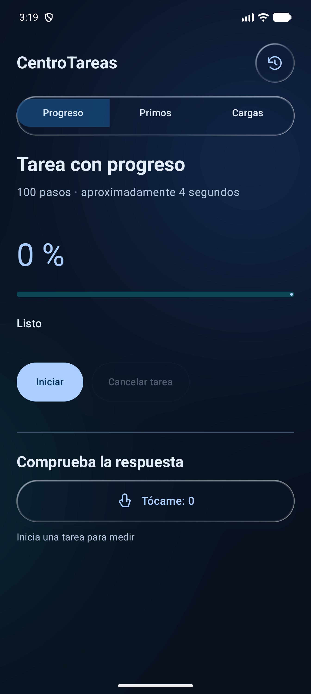
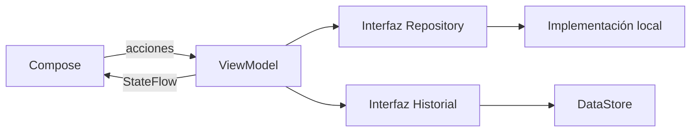

# CentroTareas

Daniella Leon · Laboratorio 14

Demostración de tareas, corrutinas y respuesta de la pantalla. Kotlin, Compose Material3 y MVVM con Repository. **main** conserva la fase1; **mejora-ia** contiene las seis mejoras y el diseño final.

[Repositorio público](https://github.com/Daniellaln/CentroTareasLeon) · [Prompts](PROMPTS.md) · [Dónde está el código](docs/GUIA_CODIGO.md) · [Pruebas](docs/VERIFICACION.md)

## Antes y después

Fase1 a la izquierda y fase2 a la derecha. Ambas son capturas de la app ejecutada.

 

## Abrir

Abre la raíz del proyecto en Android Studio. Usa **JDK21**, SDK37 y Android7 o superior. El paquete es **com.leon.centrotareas**. No requiere claves, Firebase, permisos ni Internet para las tareas; la primera sincronización sí descarga las dependencias.

## Probar

En **Progreso**, pulsa Iniciar y luego Tócame. Cancela y vuelve a empezar. El progreso viene del Repository mediante Flow y el hilo principal sigue atendiendo la pantalla.

En **Primos**, prueba1000: debe dar168. El valor inicial de cinco millones permite observar el progreso y cancelar un cálculo real, sin añadir esperas artificiales.

En **Cargas**, compara Una por una con A la vez. Las esperas simuladas son2 y3 segundos; la tabla guarda hasta20 mediciones de la sesión. Los datos de Ana Torres y sus tres pedidos son ficticios.

Abre **Pruebas de carga** para activar error, límite de2s o reintentos. Con el límite activo aparece Tardó demasiado; apágalo para completar las cargas normales. Hay tres reintentos automáticos adicionales, con esperas de0.5,1 y2s. Cancelar sigue funcionando durante esas esperas.

El botón de historial abre los **cinco últimos resultados de primos y cargas**, guardados con DataStore. Siguen ahí al cerrar y abrir la app. La tabla de comparación pertenece a la sesión; el historial sí es persistente.

## Seis mejoras y aporte propio

Se implementaron todas las opciones de fase2: progreso desde Repository, tiempo máximo, reintento automático, progreso de primos, historial DataStore y comparación de tiempos. Cada mejora tiene su propio commit y prompt de reproducción.

El aporte propio es el **medidor de respuesta**: observa intervalos reales entre fotogramas mientras hay trabajo, muestra la mayor pausa y una traza. Tócame permite comprobar además la respuesta al tocar. El medidor no es una prueba de rendimiento de un teléfono físico ni mide directamente la latencia del toque.

 

## Diseño

Azul y vidrio claro, una tarea visible e historial separado. Tema oscuro del sistema, texto grande y dos columnas en horizontal. Los iconos SVG son propios y la app usa sus VectorDrawable en drawable. El vidrio se dibuja con AGSL en Android13+ y refracta el fondo procedural compartido; en versiones anteriores usa un degradado. No refracta el texto ni las otras vistas. No se necesitaron fotografías para esta interfaz.

 

Las19 capturas están en [la galería completa](docs/GALERIA.md). Las imágenes son del emulador, sin sustituir la interfaz por un montaje.

## Arquitectura y comprobación

La UI observa StateFlow y envía acciones. El ViewModel coordina los trabajos; depende de interfaces y no recibe Context. El Repository realiza el cálculo y simula las cargas. DataStore tiene su propio adaptador. La observación de fotogramas pertenece al ciclo de vida de la vista y solo comunica timestamps.

**8 pruebas unitarias y14 instrumentadas**, sin fallos. Compilación y lint sin errores. Se comprobó persistencia real, cancelación, error y recuperación, tiempos, temas, letra1.3 y horizontal. Detalles y límites en [Verificación](docs/VERIFICACION.md).

La fase1 reconstruye el código de la guía y conserva el bloqueo deliberado solo en su commit histórico9de0c8c. El código final lo elimina. La asistencia utilizada fue Codex. PROMPTS.md contiene instrucciones para reproducir el trabajo en Gemini y deja pendiente registrar sus respuestas cuando Daniella las ejecute; no se inventa una sesión de Gemini.
