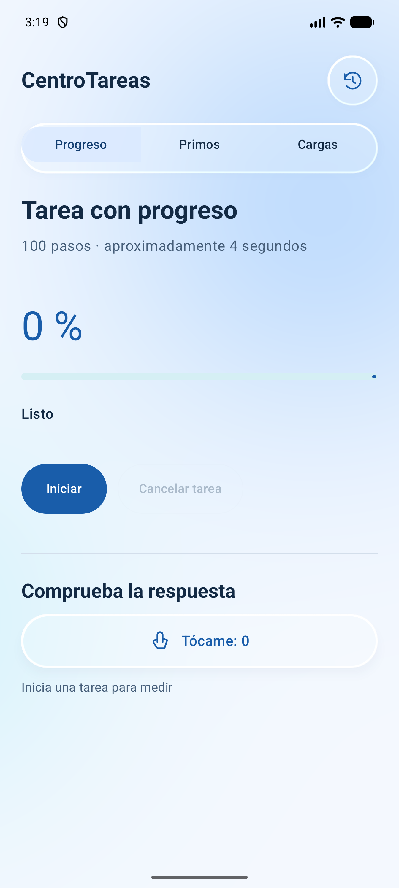
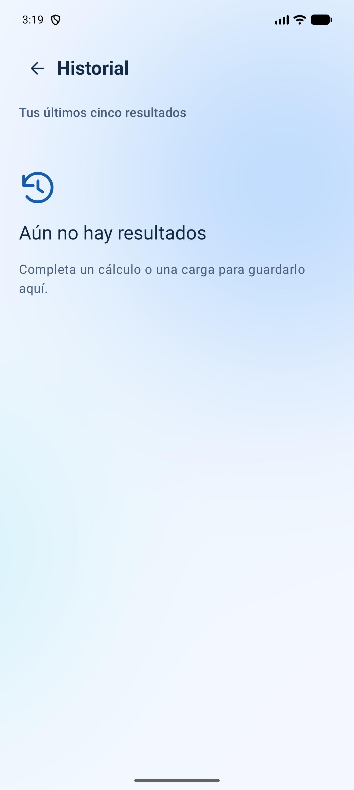
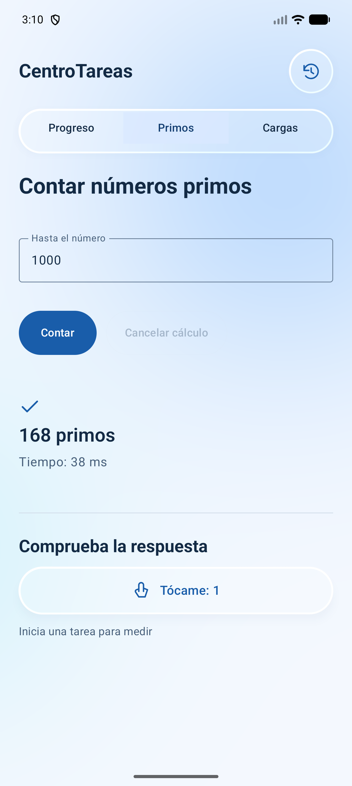
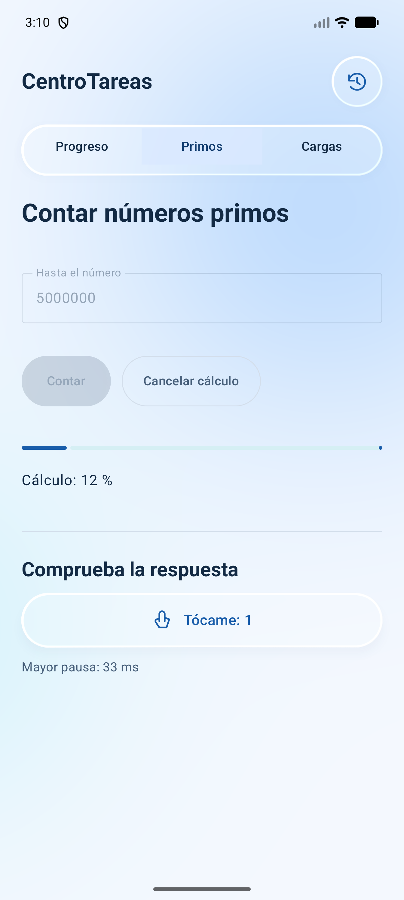
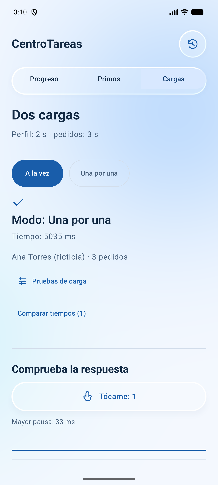
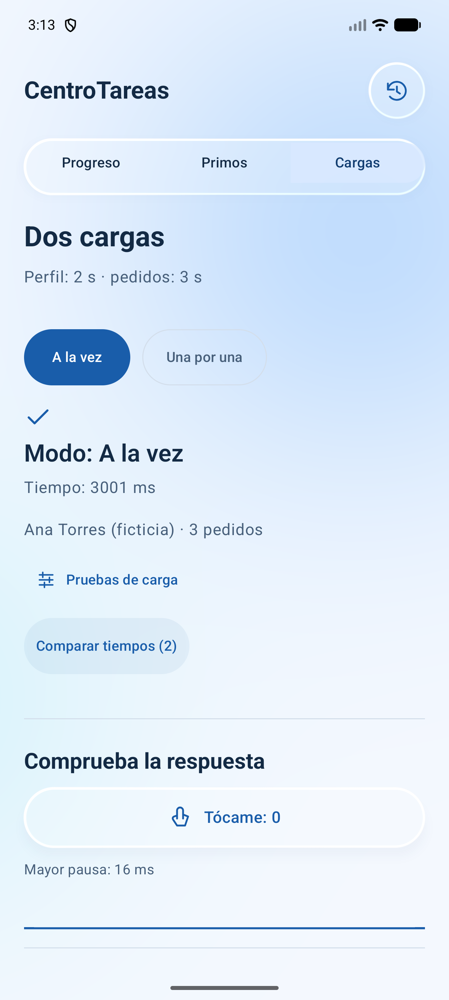
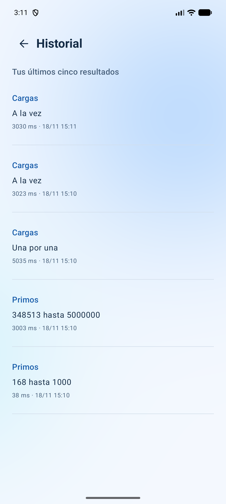
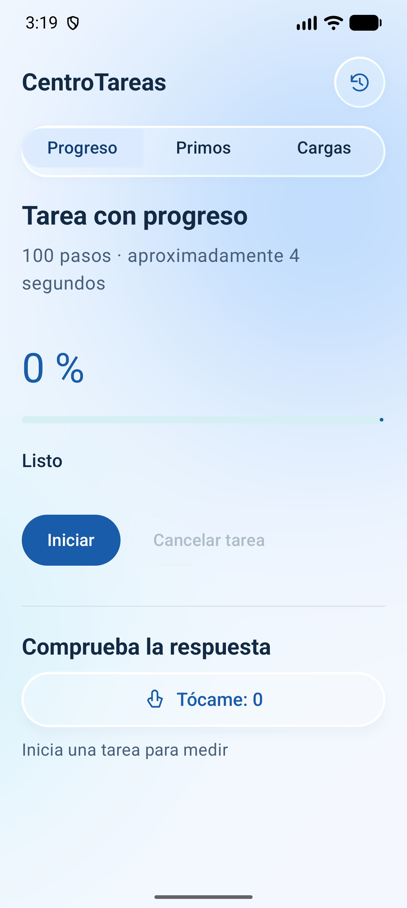

# Capturas de fase2

Pixel_8_Pro_2, API37. Imágenes de la aplicación ejecutada.

## 1. Inicio

## 2. Historial vacío

## 3. Progreso y toque durante el trabajo

## 4. Cancelación

## 5. Tarea terminada

## 6. Primos: valor de referencia

## 7. Progreso real del cálculo

## 8. Resultado de primos

## 9. Carga una por una

## 10. Carga a la vez

## 11. Comparación de tiempos

## 12. Límite de dos segundos

## 13. Reintento automático en curso

## 14. Carga recuperada

## 15. Historial

## 16. Historial tras reabrir

## 17. Tema oscuro

## 18. Texto al130%

## 19. Horizontal con dos columnas

