# Capturas de fase2

Imágenes directas de Pixel_8_Pro_2 API37. [Ver movimiento real](pruebas_fase2/procesos.mp4).

## 1. Inicio

## 2. Historial vacío

## 3. Progreso y toque durante el trabajo

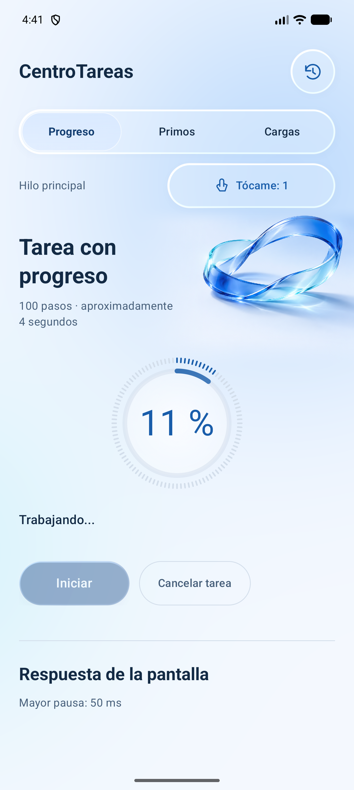

## 4. Cancelación

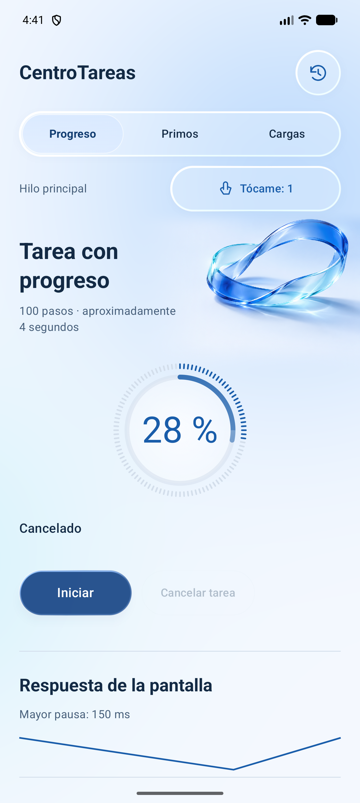

## 5. Tarea terminada

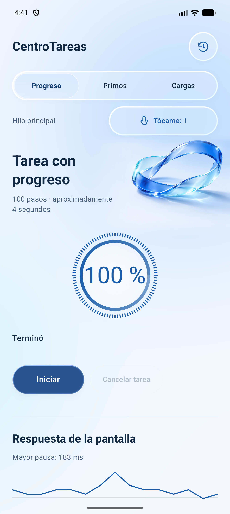

## 6. Primos: referencia

## 7. Primos en ejecución

## 8. Resultado de primos

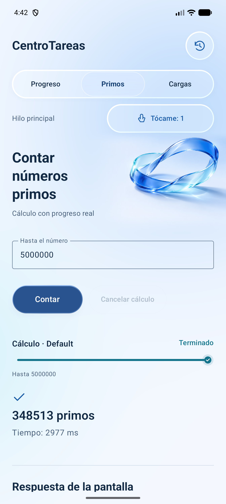

## 9. Carga secuencial terminada

## 10. Carga paralela terminada

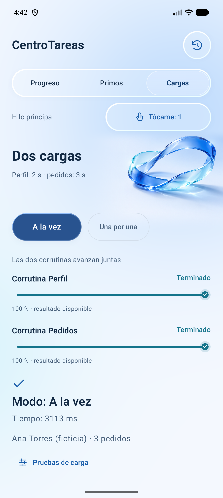

## 11. Comparación de tiempos

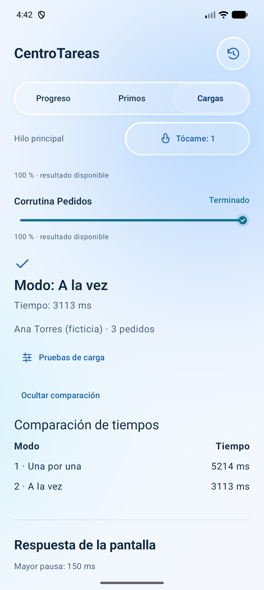

## 12. Tiempo máximo

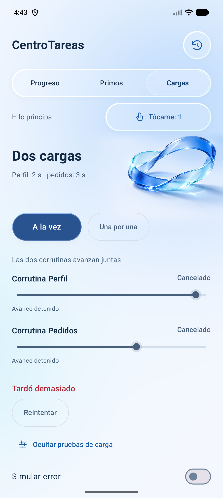

## 13. Reintento automático

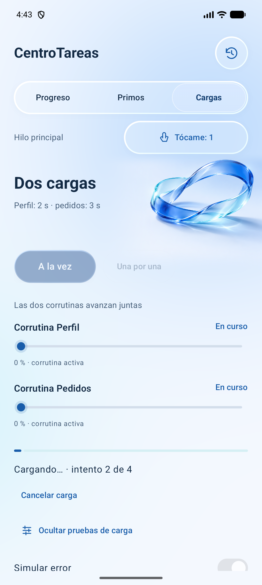

## 14. Recuperación

## 15. Historial

## 16. Historial tras reabrir

## 17. Tema oscuro

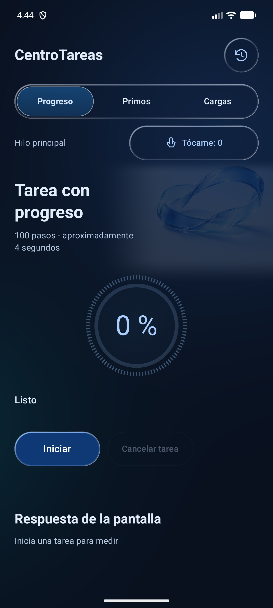

## 18. Texto grande

## 19. Horizontal

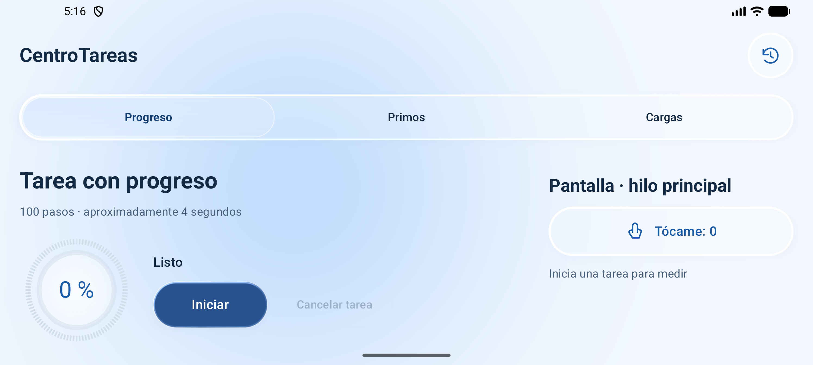

## 20. Secuencial en ejecución

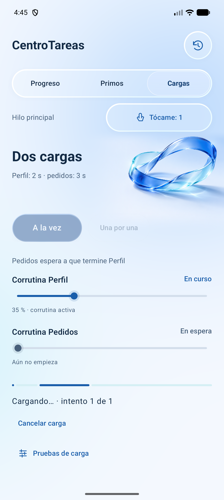

## 21. Paralelo en ejecución

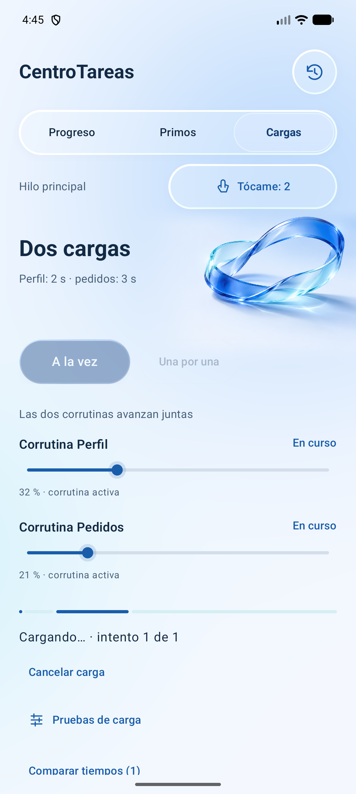
